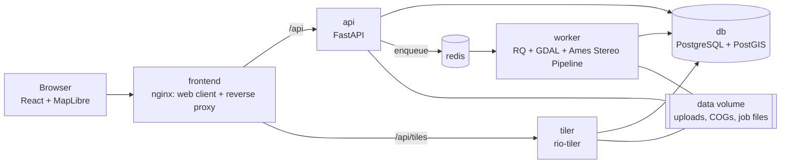

# Earthworks Monitor

Independent verification of earthworks from satellite or drone 3D data: how much material
was cut and filled, how far the works are against the design, and what changed since the
last survey — without sending a survey crew to site. Built for project owners, contractors
and quarry operators in the Gulf; English and Arabic throughout.

"Earthworks Monitor" is a working name. Change `APP_NAME` in `.env` to rename the product
everywhere (web client, API, reports).

- **How the numbers are calculated**: [METHOD.md](METHOD.md), written for clients and auditors.
- **Attribution**: uses NASA Ames Stereo Pipeline (Apache-2.0). See [NOTICE.md](NOTICE.md),
  [THIRD_PARTY.md](THIRD_PARTY.md) and `LICENSES/`.

## What it does

- **Projects, sites and zones.** Draw outlines on the map or upload GeoJSON, KML/KMZ or a
  zipped Shapefile. Zones are the work areas (cut, fill or both).
- **Survey epochs** from either
  - an uploaded DEM/DSM GeoTIFF (for example from drone photogrammetry) — this path needs
    no satellite processing and works on day one; or
  - a satellite stereo pair, turned into a DEM and orthoimage by NASA Ames Stereo Pipeline.
- **Alignment** of every survey to the site's baseline survey, using stable ground outside
  the work zones, with the alignment statistics recorded.
- **Volumes**: cut, fill and net per zone and for the site, between any two surveys or
  against a design surface. Every volume carries a ± range; changes below the level of
  detection are not counted.
- **Progress** per zone: volume achieved ÷ volume the design requires.
- **Dashboard**: map with terrain, orthoimage and blue/red cut-fill layers, epoch slider,
  volume table, progress-over-time chart.
- **PDF report** per site and survey, in English, Arabic or both.
- **Processing jobs** in a background worker, with status, live logs and retry.
- **Roles**: analysts upload, process and release; viewers see only released results of
  the projects they were given.
- **Provenance** on every result: input files and hashes, software versions, parameters,
  alignment statistics, timestamps.

## Architecture



| Service | Role |
|---|---|
| `frontend` | Serves the web client and proxies `/api` and `/api/tiles`. The only published port. |
| `api` | REST API, authentication, uploads, PDF reports. Runs database migrations on start. |
| `worker` | Background jobs: raster preparation, stereo processing with ASP, alignment, volume analyses. |
| `tiler` | Map tiles (hillshade, orthoimage, cut/fill) rendered from Cloud-Optimized GeoTIFFs, behind the same login and release rules as the API. |
| `db` | PostgreSQL 16 with PostGIS. |
| `redis` | Job queue and login rate limiting. |

Nothing outside the stack is required at run time. The optional basemap
(`BASEMAP_TILE_URL`) is the only external service; leave it empty to run fully
self-contained, for example in a GCC cloud region with data-residency requirements.

The volume engine (`backend/app/geo/volume.py`) is a plain library with no dependency on
the web layer or on ASP. Photogrammetry sits behind an interface
(`backend/app/engines/base.py`); ASP is its first implementation, and a drone
photogrammetry engine can be added by implementing the same class.

## Setup

Requires Docker with Compose v2, an x86-64 machine, and about 15 GB of free disk (the
worker image with ASP is about 10 GB; its first build downloads about 3 GB).

```bash
cd earthworks-monitor
cp .env.example .env
```

Edit `.env` and replace every `CHANGE-ME` value. `SECRET_KEY` must be at least 32
characters; the database password appears twice. Then:

```bash
docker compose up --build
```

Open http://localhost:8080 and sign in with `DEMO_ANALYST_EMAIL` / `DEMO_ANALYST_PASSWORD`
from your `.env`.

For production: set `SEED_DEMO_ON_START=false` and `COOKIE_SECURE=true`, serve behind
HTTPS, and back up the `dbdata` and `appdata` volumes.

Create users in the web client (**Users**, analysts only) or from the command line:

```bash
docker compose exec api python -m app.cli create-user --email you@example.com --role analyst
```

## Demo walkthrough

### 1. Synthetic site (created automatically)

On first start a demo project is created: a fictional desert site with a fill zone, a cut
zone, a design surface and four synthetic surveys at 0 %, 30 %, 65 % and 90 % of the
design, each with measurement noise and a deliberate vertical offset. It takes about half
a minute.

1. Sign in as the analyst and open **Demo – Desert Logistics Platform**.
2. On the site card choose **Open dashboard**.
3. Move the **Survey** slider: the terrain, the cut/fill layer, the volume table and the
   marker on the progress chart follow. Each survey card shows the vertical shift that
   alignment removed.
4. Change **Compare** to see the change since the previous survey, what remains to the
   design, or the planned quantities.
5. Under **Report**, pick a language and choose **PDF report**.
6. Sign in as the viewer (`DEMO_VIEWER_*`) to see the read-only view of released results.
7. Switch language with the **العربية / English** link in the top bar.

To try an upload, add a survey under **Upload survey or design**. Synthetic test rasters
can be generated with `backend/app/geo/synthetic.py`.

### 2. Satellite stereo with Ames Stereo Pipeline

First confirm ASP runs in the worker:

```bash
docker compose run --rm worker python -m app.engines.asp.smoke
```

The stereo demo builds a project over Jebel Hafeet (UAE / Oman border): arid, with real
relief. It downloads the Copernicus GLO-30 DEM from its public AWS bucket as the reference
surface (the only step that needs internet; pass `--reference file.tif` to avoid it).

**Without any imagery.** ASP's `sat_sim` renders a stereo pair from the reference terrain
with a quarry of known volume cut into it; the stereo path then runs on that pair. The
imagery is synthetic; the processing is the real one.

```bash
docker compose run --rm worker python -m app.demo --simulate --queue
```

Open the new project, then the site dashboard, then **Processing jobs** to watch the log.
When the job is done the dashboard shows the survey, its orthoimage and the cut volume
next to the known answer printed by the command.

**With an ASTER scene.** Download an `AST_L1A` scene covering 24.07° N, 55.77° E from
[NASA Earthdata Search](https://search.earthdata.nasa.gov/search) (free account; choose
*ASTER L1A Reconstructed Unprocessed Instrument Data V004*, cloud-free, with bands 3N and
3B). Put the `.hdf` in a folder and run:

```bash
docker compose run --rm -v /path/to/folder:/demo:ro worker python -m app.demo --scene /demo/AST_L1A_XXXX.hdf --date 2023-05-14
```

**Resolution.** ASTER (15 m) and GLO-30 (30 m) are for demonstration only: most real
earthworks are below the level of detection at this resolution, and the dashboard and the
report say so wherever such data is shown. Production use expects sub-metre satellite
stereo (for example Maxar or Pléiades Neo) or drone DSMs.

## Configuration

Everything is set through environment variables; `.env.example` documents each one.
Nothing is hard-coded and no secret is committed. The main groups:

| Group | Variables |
|---|---|
| Branding | `APP_NAME` |
| Database, queue | `DATABASE_URL`, `POSTGRES_*`, `REDIS_URL` |
| Sign-in | `SECRET_KEY`, `ACCESS_TOKEN_TTL_MINUTES`, `COOKIE_SECURE`, `LOGIN_*` |
| Storage, uploads | `DATA_DIR`, `MAX_UPLOAD_MB`, `MAX_DEM_UPLOAD_MB`, `MAX_STEREO_UPLOAD_MB` |
| Volumes and uncertainty | `LOD_SIGMA_MULTIPLIER`, `CONFIDENCE_Z`, `UNCERTAINTY_CORRELATION_PIXELS`, `STABLE_ZONE_BUFFER_M`, `MIN_STABLE_PIXELS` |
| Alignment | `ALIGNMENT_METHOD_UPLOAD`, `ALIGNMENT_METHOD_STEREO`, `PC_ALIGN_*`, `GEOID_CONVERSION` |
| Stereo engine | `PHOTOGRAMMETRY_ENGINE`, `ASP_THREADS`, `ASP_PROCESSES`, `STEREO_ALGORITHM`, `STEREO_SUBPIXEL_MODE` |
| Web | `WEB_PORT`, `BASEMAP_TILE_URL`, `BASEMAP_ATTRIBUTION` |

## Repository layout

```
earthworks-monitor/
  docker-compose.yml  .env.example  README.md  METHOD.md  NOTICE.md  THIRD_PARTY.md
  LICENSES/                licence texts of bundled software
  scripts/collect_licenses.py
  backend/
    Dockerfile             api and tiler image
    Dockerfile.worker      worker image with ASP 3.7.0 (pinned)
    app/
      config.py            settings from environment variables only
      models.py  schemas.py  deps.py  security.py  storage.py
      routers/             auth, users, projects, sites + zones, surfaces + analyses + jobs + report
      geo/vector_io.py     outline parsing and validation
      geo/raster_io.py     raster validation, reprojection to COG
      geo/volume.py        DEM of difference, volumes, uncertainty (pure library)
      geo/tiles.py         hillshade, orthoimage and cut/fill tile rendering
      geo/synthetic.py     synthetic terrain with known volumes (tests, demo seed)
      engines/base.py      photogrammetry engine interface
      engines/asp/         ASP toolchain, typed command wrappers, engine, smoke test
      services/            surface ingest + alignment, stereo surveys, analyses, progress
      jobs/runner.py       job execution, logs, retry
      reports/             PDF report: template, translations, maps, chart, fonts
      tiler.py  worker.py  cli.py  seed.py  demo.py
    alembic/               database migrations
    tests/
  frontend/
    src/pages/             Login, Projects, Project (outlines), Site (dashboard), Jobs, Users
    src/components/        MapView, VolumeTable, ProgressChart, SurfaceUpload
    src/i18n/              en.json, ar.json — every user-facing string
```

## Development and tests

Backend tests run against a real PostGIS database and Redis:

```bash
docker run -d --name em-test-db -e POSTGRES_PASSWORD=test -e POSTGRES_DB=em_test -p 55432:5432 postgis/postgis:16-3.4
```

```bash
docker run -d --name em-test-redis -p 56379:6379 redis:7-alpine
```

```bash
cd backend && python3.11 -m venv .venv && .venv/bin/pip install -e '.[dev]' && .venv/bin/pytest
```

The suite covers volume maths on synthetic terrain with known volumes, CRS handling,
alignment and error propagation, zone clipping, bad-input messages, access rules, the
stereo engine wrappers and the report. Tests that drive the real ASP tools are skipped
unless `ASP_PREFIX` points at an ASP conda environment; inside the worker image they run.
The PDF tests need Pango installed on the machine (it is in the api image).

After changing Python dependencies, regenerate `backend/requirements.lock` with
`pip freeze` (the images install from it) and re-run `scripts/collect_licenses.py`.

Frontend with hot reload (expects the API on `localhost:8000`, or set `VITE_API_PROXY`):

```bash
cd frontend && npm install && npm run dev
```

API documentation is served at `/api/docs`.

## Deviations from the original brief

- **Tile server**: a small rio-tiler service instead of stock TiTiler, so that tiles obey
  the same login and release rules as the data.
- **ASP installation**: the official conda package rather than the release tarball.
- **Alignment**: `pc_align` in its Nuth & Kääb mode for stereo surveys (plain ICP was
  several times less accurate on a known shift); uploaded DEMs get a vertical shift by
  default (`ALIGNMENT_METHOD_UPLOAD=pc_align` switches them to the 3-D method).
- **Charts**: drawn as plain SVG, without a chart library.
- **Viewer access per project** was added: a viewer sees only the projects ticked for them.
- **Job queue**: RQ rather than Celery.

## Known limitations

**Verified once, on one scene**

- The ASTER path has been run on one real scene (`AST_L1A`, 13 November 2023, Jebel
  Hafeet) against Copernicus GLO-30. It produced a 30 m DEM that agrees with the
  reference to 8.7 m RMSE on stable ground after the vertical shift. The 3-D alignment
  proposed a 115 m horizontal move, which did not improve the agreement and was rejected
  by the acceptance check, so only the vertical shift was applied. Other scenes, and
  whether a horizontal correction can be made reliable at this resolution, are untested.
- The images build with their operating-system package steps as written, but were built
  behind a TLS-inspecting proxy (extra CA certificate, HTTPS package mirror). A build on
  an ordinary network has not been run.

**Measurement**

- 3-D alignment is a translation (no rotation or tilt correction). Tilt is measured and
  widens the ± range. It needs terrain with relief; on flat sites it is rejected
  automatically and only the vertical shift is applied.
- Only WGS84-ellipsoid, EGM96 and EGM2008 heights are converted; a local project datum
  must match the site's. Heights are assumed to be in metres.
- A pixel counts towards a zone when its centre is inside; there is no partial-pixel
  weighting.
- Progress counts volume, so material placed above the design level counts too and
  progress can exceed 100 %.
- One stereo pair per survey (no multi-pair mosaics), no ground control points, one
  design surface per site.

**Scale**

- Rasters are processed block by block, but the `nuth` alignment estimate loads both DEMs
  into memory; very large sub-metre rasters may need a bigger worker or
  `PC_ALIGN_METHOD=point-to-plane`.
- Reports are rendered inside the API request (a few seconds for the demo site).
- Files are stored on a Docker volume; object storage is a later swap (`app/storage.py`).
- The worker image is about 10 GB and x86-64 only, as ASP's conda package is.

**Product**

- Editing an existing outline is API-only (`PATCH`); the web client can add and delete.
- No password-reset flow; an analyst resets passwords via the API or `app.cli`.
- Sessions cannot be revoked individually before they expire (deactivating a user does
  cut them off immediately).
- The report has no client logo or sign-off block.

**Out of scope for this MVP**: billing, multi-tenant administration, a mobile app,
satellite tasking or ordering, and AI object detection.
